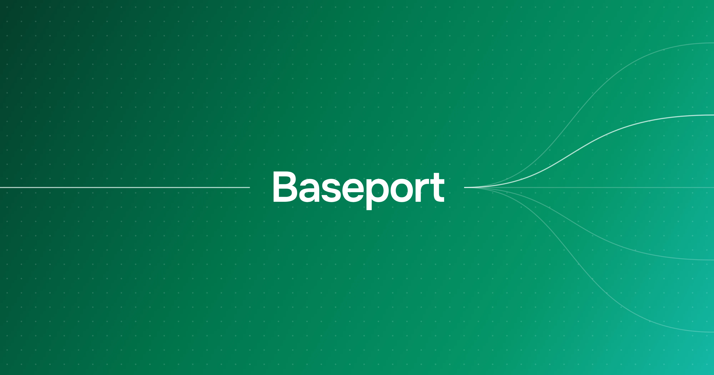

# Baseport

<a href="LICENSE"></a>


Meet Baseport: a .NET-first, single-binary backend designed to deliver sub-millisecond performance. It lets you define your tables in the console to instantly get a typed REST API, live updates, exposable web forms and an admin interface without writing any boilerplate. Point your mobile, web, or desktop app at it and build the rest.

Built on .NET 11, Baseport runs as one process over one SQLite database file. There is no database server to run alongside it, allowing for blazing-fast product development. Copy the binary to a server, back up the file. That is all it takes for your deployment. Reads stay in single-digit milliseconds at a quarter of a million rows.

> **Warning!** In development. The database format and the API surface both still move between commits. Do not put production data in it.

## Installation

**Linux**

```bash
curl -sSL https://raw.githubusercontent.com/melosso/baseport/main/Scripts/install.sh | bash
```

**Windows**

```powershell
iwr https://raw.githubusercontent.com/melosso/baseport/main/Scripts/install.ps1 | iex
```

Then run `baseport` to start it, or `baseport service` to install it as a service.

**Docker**

```bash
docker compose up -d
docker compose logs baseport | grep "one-time admin password"
```

Browse to `http://localhost:5000/_/admin` and sign in with the one-time admin username and password the first start printed.

For Docker, define `baseport` as a shell function so the same commands work there:

```bash
baseport() {
  local compose="docker compose -f $HOME/baseport/docker-compose.yml"
  if [ "$1" = "update" ]; then
    $compose pull && $compose up -d
  else
    $compose exec baseport /app/Baseport "$@"
  fi
}
```

## Documentation

Full documentation lives at **[melosso.github.io/baseport](https://melosso.github.io/baseport/docs/)**.

- [How to use Baseport](https://melosso.github.io/baseport/docs/how-to-use) walks from an empty console to a working REST call
- [Tables and fields](https://melosso.github.io/baseport/docs/tables-and-fields), [Access rules](https://melosso.github.io/baseport/docs/access-rules) and [Relations](https://melosso.github.io/baseport/docs/relations) cover modelling your data
- [Authentication](https://melosso.github.io/baseport/docs/authentication) covers API tokens, end user accounts, single sign-on and anonymous accounts
- [Forms and embeds](https://melosso.github.io/baseport/docs/forms) covers publishing a table as a public page
- [Going to production](https://melosso.github.io/baseport/docs/going-to-production) covers configuration, backups and the switches that are off by default
- [Web APIs reference](https://melosso.github.io/baseport/docs/api) lists every published route

Your own instance also serves its OpenAPI document at `/api/openapi.json` and renders it at `/docs`.

## Contributing

Contributions are greatly appreciated. For any changes beyond simple bug fixes, please open an issue first (use tag: `enhancement`) so we can align on the proposal and make sure it fits the project roadmap.

See [Contributing](?tab=contributing-ov-file) for building and testing from source.

## License

Licensed under the **EUPL 1.2** license. See [LICENSE](LICENSE) for details.
